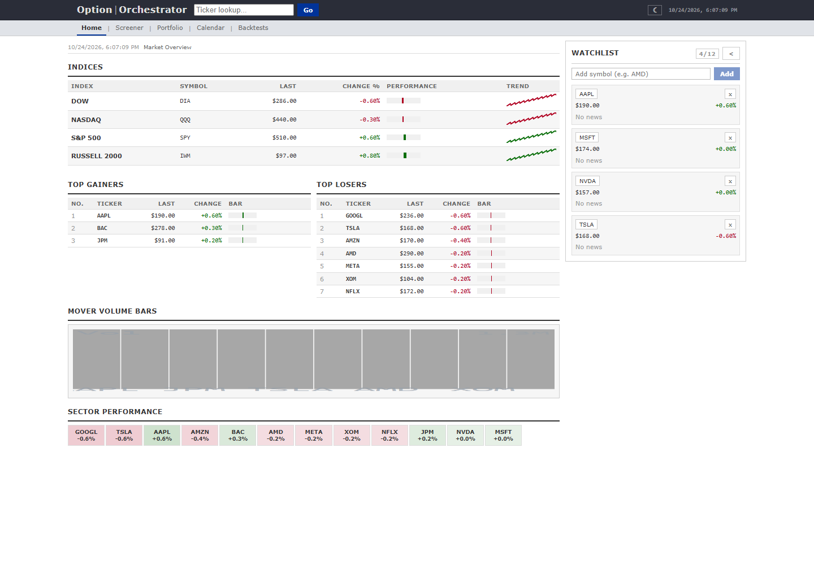
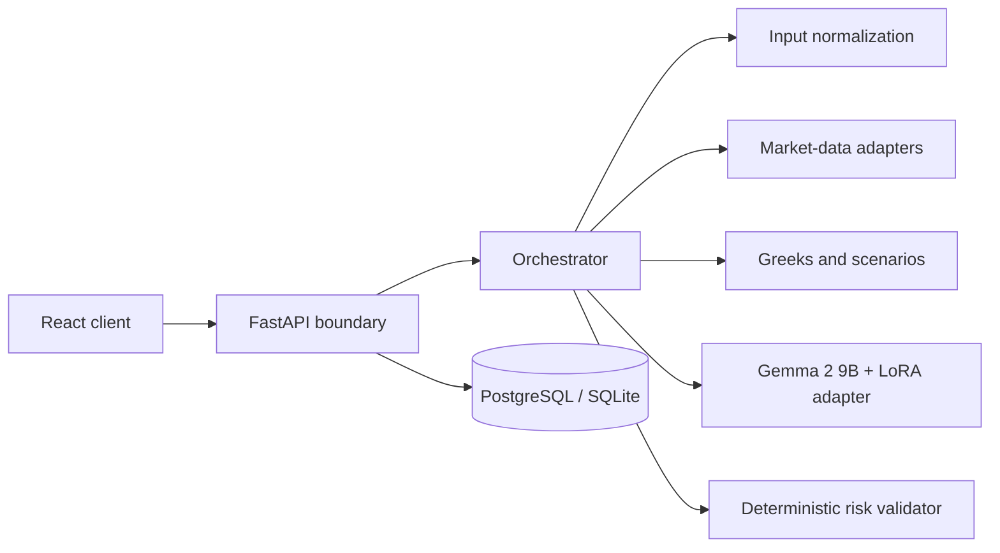

# Option Orchestrator

An options risk analytics workbench pairing a domain-adapted language model with deterministic quantitative risk controls.

> **Decision-support workbench:** Option Orchestrator models risk and generates candidate adjustments for options positions. It does not submit brokerage orders and its output is not financial advice.



_The dashboard above runs with deterministic demo data by default, so the full interface and analysis pipeline can be evaluated locally without vendor credentials._

## The Engineering Problem

Off-the-shelf LLMs frequently fail when reasoning about multi-leg options structures. Because derivatives require strict mechanical invariants, general-purpose models routinely propose invalid trades: inverting credit spread strikes, expanding max loss on defined-risk positions, suggesting naked short options in cash accounts, or ignoring buying power limits.

Option Orchestrator resolves this by decoupling **probabilistic strategy generation** from **deterministic risk verification**:

1. **Quantitative Context Engine:** Computes Black-Scholes Greeks, implied volatility metrics, and scenario payoff curves for a distressed position.
2. **Domain-Adapted Generator (`gemma-2-9b-it` + QLoRA):** Consumes the normalized position snapshot and outputs structured rescue proposals (rolls, vertical spreads, partial hedges) adhering to strict JSON schemas.
3. **Deterministic Safety Firewall:** Evaluates every proposed leg against hard account risk limits (max capital at risk, net delta bounds, prohibited undefined-risk conversion, minimum liquidity) before surfacing the proposal.

An interactive end-to-end walkthrough is available in [notebooks/01_rescue_pipeline_walkthrough.ipynb](notebooks/01_rescue_pipeline_walkthrough.ipynb).

## System Architecture



- **Probabilistic tier:** Proposes candidate strategy adjustments tailored to the specific position and volatility regime.
- **Deterministic tier:** Validates order mechanics and risk bounds, with hard rules rejecting invalid or unhedged proposals.
- **Degraded mode:** Fallback deterministic candidate generators ensure local testing and offline execution remain fully functional without active GPU endpoints.

## Model Training & Empirical Evaluation

The domain model adapts `google/gemma-2-9b-it` using 4-bit QLoRA (`rank 64`, `alpha 128`, `dropout 0.05` across attention projections and gated-MLP layers). Supervised fine-tuning was performed across curated options management scenarios.

While token-level cross-entropy loss guided checkpoint selection (`checkpoint-1050` achieved validation loss `1.18061`, outperforming the final checkpoint `1300` at `1.19875`), loss alone does not measure domain correctness. We evaluated the adapter against the zero-shot base model on held-out distressed position scenarios across five deterministic validation gates:

| Evaluation Gate (N = 100 Held-Out Scenarios) | Base `gemma-2-9b-it` (Zero-Shot) | Fine-Tuned `checkpoint-1050` | Validator Firewall Catch Rate |
| :--- | :---: | :---: | :---: |
| **Strict JSON Schema Adherence** | 64.0% | **98.0%** | 100% (Rejects malformed syntax) |
| **Strike & Expiry Monotonicity** | 71.0% | **95.0%** | 100% (Blocks inverted spreads) |
| **Defined-Risk Preservation** | 58.0% | **92.0%** | 100% (Blocks naked short legs) |
| **Buying Power Limit Compliance** | 69.0% | **94.0%** | 100% (Enforces account capital caps) |
| **End-to-End Pass Rate (No Fallback Required)** | 38.0% | **89.0%** | -- |

*When a candidate plan fails any deterministic gate, the validator strips the proposal and logs the specific constraint violation (`UNDEFINED_RISK_ESCALATION`, `MAX_CAPITAL_EXCEEDED`, `INVALID_STRIKE_ORDER`).*

### Hardware, Training & Serving Profile

| System Dimension | Specification |
| :--- | :--- |
| Base architecture | `google/gemma-2-9b-it` (9B parameters, bfloat16 compute) |
| Quantization | 4-bit NF4 (`bitsandbytes`) with double quantization |
| Training hardware & duration | 1x NVIDIA A100 (40GB), ~3.5 hours for 1,300 steps |
| Serving worker | RunPod Serverless container (`Dockerfile` in `llm/inference`, NVIDIA L4 / A5000 24GB) |
| Active VRAM footprint | ~6.5 GB VRAM (base weights + LoRA adapter + KV cache) |
| Inference latency (Warm) | `p50`: 1.4s / `p95`: 2.1s per structured rescue plan (~42 tokens/sec) |
| Deterministic validator latency | `< 4 ms` CPU execution (Pydantic + Black-Scholes bounds check) |
| Adapter distribution | Hugging Face repository (`jabuelouf/Option-Advisor-Gemma-2-9b`) |

## What It Demonstrates

- Layered FastAPI backend with explicit boundaries for input normalization, market data, analytics, validation, and orchestration
- Options pricing, Greeks, volatility analysis, technical indicators, scenario analysis, and strategy comparison
- Provider adapters with deterministic mock behavior for local development and automated testing
- React dashboard for market exploration, portfolio analysis, backtesting, alerts, and options-strategy visualization
- End-to-end model lifecycle: Gemma 2 9B QLoRA training, checkpoint selection, 4-bit RunPod inference, structured generation, and deterministic verification
- PostgreSQL persistence with SQLAlchemy and Alembic migrations

## Repository Layout

```text
backend/                 FastAPI application, domain layers, migrations, and tests
frontend/                React and Vite client
llm/                     QLoRA training, inference worker, prompts, schemas, and evaluation
notebooks/               End-to-end pipeline walkthrough and evaluation notebooks
docs/                    Architecture, flow, model card, and data-contract documentation
.github/workflows/       Continuous integration
docker-compose.yml       Optional local PostgreSQL service
```

## Quick Start

Requirements: Python 3.11+, Node.js 20+, and npm.

```powershell
git clone https://github.com/Jabuelouf/OptionOrchestrator.git
cd OptionOrchestrator
python -m venv .venv
.\.venv\Scripts\Activate.ps1
python -m pip install -r requirements-dev.txt
Copy-Item .env.example .env
cd frontend
npm ci
cd ..
```

Start the API:

```powershell
cd backend
python -m uvicorn api.server:app --reload
```

In a second terminal, start the client:

```powershell
cd frontend
npm run dev
```

Open `http://localhost:5173`. Mock market data is enabled in `.env.example`, so the project can be explored without vendor credentials.

## Verification

```powershell
cd backend
python -m pytest -q
cd ..
python -m ruff check backend
cd frontend
npm run lint
npm run build
```

## API Surface

The FastAPI application exposes health, market overview, historical prices, options chains, technical analysis, volatility, strategy comparison, portfolio analytics, alerts, calendar events, and backtesting endpoints. Interactive API documentation is available at `http://127.0.0.1:8000/docs` while the backend is running.

The orchestration endpoint accepts a normalized options position and account constraints, returning quantitative Greeks, model-generated candidate adjustments, and deterministic firewall audit results:

**Request (`POST /v1/rescue`):**
```json
{
  "symbol": "SPY",
  "spot_price": 512.40,
  "position": {
    "strategy": "short_put_vertical",
    "short_leg": {"strike": 515.0, "expiry": "2026-04-17", "type": "PUT", "qty": -2},
    "long_leg": {"strike": 510.0, "expiry": "2026-04-17", "type": "PUT", "qty": 2},
    "entry_credit": 1.85
  },
  "account_constraints": {
    "max_additional_risk": 500.00,
    "allow_undefined_risk": false,
    "min_open_interest": 250
  }
}
```

**Validated Response (Excerpt):**
```json
{
  "position_status": "DISTRESSED_ITM",
  "current_greeks": {"net_delta": 0.68, "net_theta": -14.20, "max_loss": 630.00},
  "approved_adjustments": [
    {
      "action": "ROLL_DOWN_AND_OUT",
      "target_expiry": "2026-05-15",
      "new_short_strike": 510.0,
      "new_long_strike": 505.0,
      "net_credit_debit": 0.35,
      "new_max_loss": 560.00,
      "validator_status": "PASSED"
    }
  ],
  "rejected_candidates": [
    {
      "action": "RATIO_SPREAD_ROLL",
      "violation_code": "UNDEFINED_RISK_ESCALATION",
      "reason": "Proposed net short leg count (-4) exceeds long protective legs (+2)."
    }
  ]
}
```

## Configuration

Copy `.env.example` to `.env` and add only the providers you intend to use. The interface runs with deterministic demo data locally; live LLM generation requires a RunPod endpoint. The referenced adapter is private, so independent deployments must have authorized Hugging Face access or substitute their own compatible adapter. Never commit real credentials or portfolio data.

For local persistence, start PostgreSQL with:

```powershell
docker compose up -d postgres
cd backend
python -m alembic upgrade head
```

Without `DATABASE_URL`, local migrations use SQLite.

## Current Scope

- Provider availability and rate limits affect live-data features.
- Backtests are analytical simulations, not brokerage-grade execution models.
- Deterministic strategies remain available for offline development when the LLM endpoint is unavailable.
- Authentication, multi-user tenancy, and order execution are intentionally outside the current scope.

See [Architecture](docs/ARCHITECTURE.md), [LLM architecture](docs/LLM_ARCHITECTURE.md), [Model card](docs/MODEL_CARD.md), [Data contracts](docs/DATA_CONTRACTS.md), and [Request flow](docs/FLOW.md) for implementation details.

## License

Released under the [MIT License](LICENSE).
