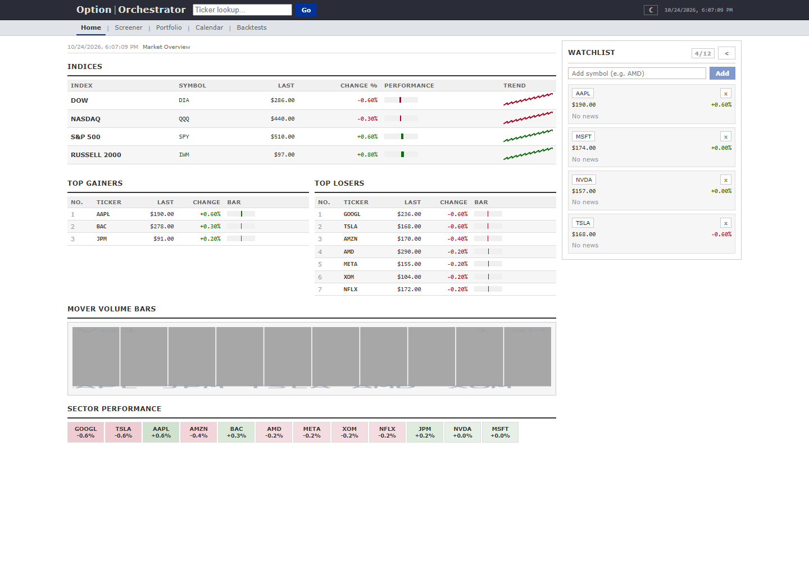
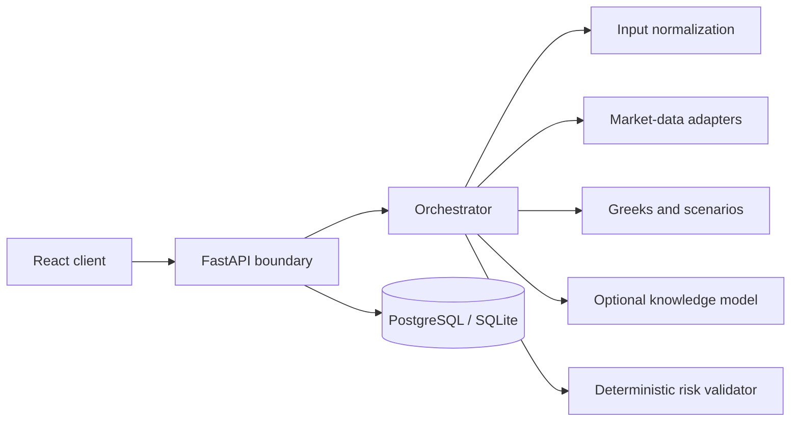

# Option Orchestrator

An options analytics workbench that combines market data, quantitative models, deterministic risk controls, and optional LLM-assisted strategy generation.

> **Portfolio project:** Option Orchestrator is an educational decision-support system. It does not execute trades and its output is not financial advice.



_The dashboard above uses the repository's deterministic demo-data provider, so the interface can be evaluated without paid API credentials._

## What it demonstrates

- A layered FastAPI backend with explicit boundaries for input normalization, market data, analytics, validation, and orchestration
- Options pricing, Greeks, volatility analysis, technical indicators, scenario analysis, and strategy comparison
- Provider adapters with deterministic mock behavior for local development and automated testing
- A React dashboard for market exploration, portfolio analysis, backtesting, alerts, and options-strategy visualization
- Optional hosted-model integration with rule-based fallbacks and validation before recommendations are returned
- PostgreSQL persistence with SQLAlchemy and Alembic migrations

## Architecture



The central design rule is that probabilistic model output is advisory. Deterministic validation remains the final safety boundary, and no component submits orders.

## Repository layout

```text
backend/                 FastAPI application, domain layers, migrations, and tests
frontend/                React and Vite client
docs/                    Architecture, flow, and data-contract documentation
.github/workflows/       Continuous integration
docker-compose.yml       Optional local PostgreSQL service
```

## Quick start

Requirements: Python 3.11+, Node.js 20+, and npm.

```powershell
git clone https://github.com/Jabuelouf/OptionOrchestrator.git
cd OptionOrchestrator
python -m venv .venv
.\.venv\Scripts\Activate.ps1
python -m pip install -r requirements-dev.txt
Copy-Item .env.example .env
cd frontend
npm ci
cd ..
```

Start the API:

```powershell
cd backend
python -m uvicorn api.server:app --reload
```

In a second terminal, start the client:

```powershell
cd frontend
npm run dev
```

Open `http://localhost:5173`. Mock market data is enabled in `.env.example`, so the project can be explored without vendor credentials.

## Verification

```powershell
cd backend
python -m pytest -q
cd ..
python -m ruff check backend
cd frontend
npm run lint
npm run build
```

## API surface

The FastAPI application exposes health, market overview, historical prices, options chains, technical analysis, volatility, strategy comparison, portfolio analytics, alerts, calendar events, and backtesting endpoints. Interactive API documentation is available at `http://127.0.0.1:8000/docs` while the backend is running.

The orchestration endpoint accepts a normalized options position and account constraints:

```http
POST /v1/rescue
Content-Type: application/json
```

It returns candidate adjustments together with quantitative context and validator results.

## Configuration

All integrations are optional. Copy `.env.example` to `.env` and add only the providers you intend to use. Never commit real credentials or portfolio data.

For local persistence, start PostgreSQL with:

```powershell
docker compose up -d postgres
cd backend
python -m alembic upgrade head
```

Without `DATABASE_URL`, local migrations use SQLite.

## Current scope

- Provider availability and rate limits affect live-data features.
- Backtests are analytical simulations, not brokerage-grade execution models.
- Hosted knowledge-model support is optional; deterministic strategies remain available without it.
- Authentication, multi-user tenancy, and order execution are intentionally outside the current scope.

See [Architecture](docs/ARCHITECTURE.md), [Data contracts](docs/DATA_CONTRACTS.md), and [Request flow](docs/FLOW.md) for implementation details.

## License

Released under the [MIT License](LICENSE).
