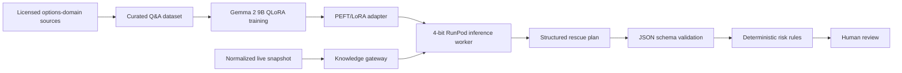

# LLM architecture

Option Orchestrator uses a domain-adapted language model to propose options-position adjustments while preserving deterministic control over risk.

## Lifecycle

## Training

`llm/training` performs supervised fine-tuning against question/answer records. The base model and hyperparameters are environment-configurable. Only the adapter is saved, keeping the resulting artifact small relative to the base model.

Raw books, extracted text, generated datasets, and model artifacts are not included in this repository. This prevents accidental publication of copyrighted source material, personal data, cloud credentials, or large binaries.

## Inference

`llm/inference` loads the base model in 4-bit precision, attaches the trained adapter, applies Gemma's chat template, and exposes a RunPod serverless handler. The FastAPI application calls it through `KnowledgeGateway` and requests a strict JSON contract.

If the endpoint is unavailable or its response cannot be parsed, the application uses conservative deterministic candidates. This keeps local demos and automated tests reproducible without pretending that fallback output came from the model.

## Verification firewall

`llm/evaluation` contains the public prompt pack, snapshot and plan schemas, synthetic examples, and deterministic validation utilities. The safety boundary rejects malformed output, disallowed undefined-risk orders, excessive position-size increases, and plans without explicit triggers or guardrails.

The governing principle is: **the LLM proposes; rules validate; a human decides.** No LLM component stores brokerage credentials or submits orders.
