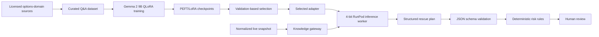

# LLM architecture

Option Orchestrator uses a domain-adapted language model to propose options-position adjustments while preserving deterministic control over risk.

## Lifecycle

## Training

`llm/training` performs supervised fine-tuning against question/answer records.
The recorded artifact adapts `google/gemma-2-9b-it` with 4-bit QLoRA. Its LoRA
configuration uses rank 64, alpha 128, dropout 0.05, and targets the attention
and gated-MLP projection layers. Only adapter state is published to the private
model repository; the base-model weights remain in the upstream repository.

The run retained checkpoints 1050, 1150, 1200, 1250, and 1300. Trainer metadata
records checkpoint 1050 as the best checkpoint by validation loss (`1.18061`),
compared with `1.19875` at checkpoint 1300. Deployment therefore selects
checkpoint 1050 by default. Task-level evaluation should still compare both,
because language-model loss does not directly measure options reasoning, schema
compliance, or safety.

Raw books, extracted text, generated datasets, and model artifacts are not included in this repository. This prevents accidental publication of copyrighted source material, personal data, cloud credentials, or large binaries.

## Inference

`llm/inference` loads the base model in 4-bit precision, attaches the selected
adapter subfolder, applies Gemma's chat template, and exposes a RunPod serverless
handler. The FastAPI application calls it through `KnowledgeGateway` and requests
a strict JSON contract.

If the endpoint is unavailable or its response cannot be parsed, the application uses conservative deterministic candidates. This keeps local demos and automated tests reproducible without pretending that fallback output came from the model.

## Verification firewall

`llm/evaluation` contains the public prompt pack, snapshot and plan schemas, synthetic examples, and deterministic validation utilities. The safety boundary rejects malformed output, disallowed undefined-risk orders, excessive position-size increases, and plans without explicit triggers or guardrails.

The governing principle is: **the LLM proposes; rules validate; a human decides.** No LLM component stores brokerage credentials or submits orders.
